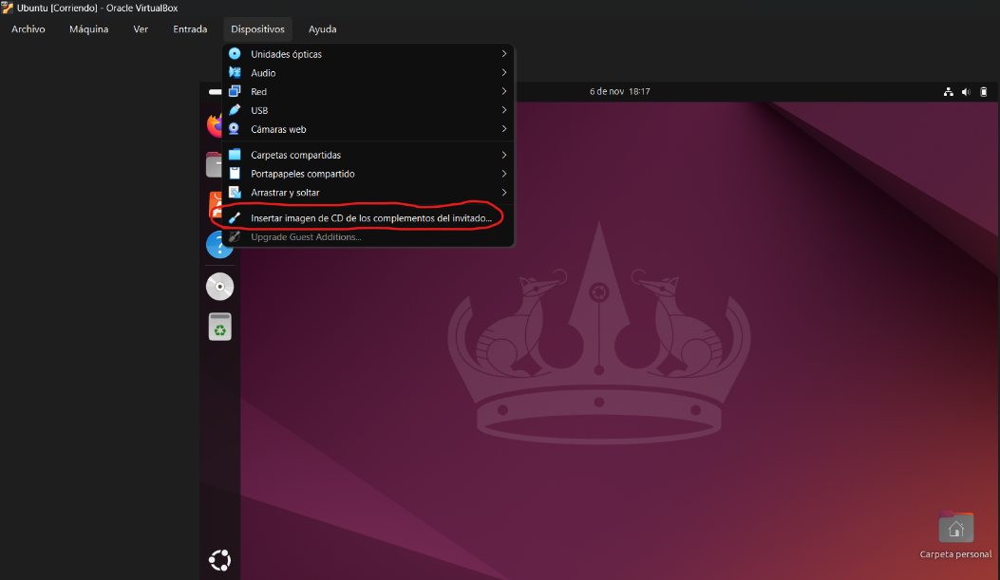
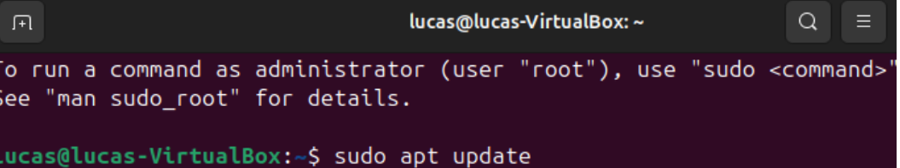
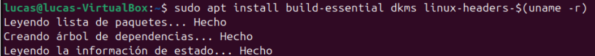
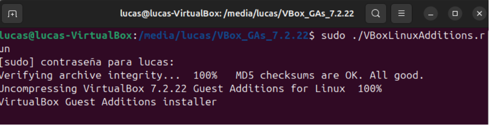

# Despliegue-SO
Despliegue, configuración y documentación de ubuntu en Virtual Box
## Trabajo de despliegue de SO
Hecho por Francisco, Roberto y Lucas

##PLANIFICACIÓN Y ASIGNACIÓN DE RECURSOS

##SECUENCIA DE ARRANQUE

##INSTALACIÓN LIMPIA

##Optimización e Integración

Primer paso actualizamos la lista de paquetes disponibles

Segundo paso instalamos un paquete con las herramientas para compilar el código

Tercer paso terminamos instalando el guest additions

