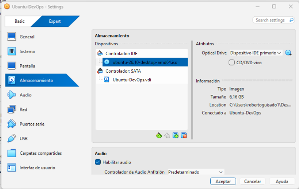
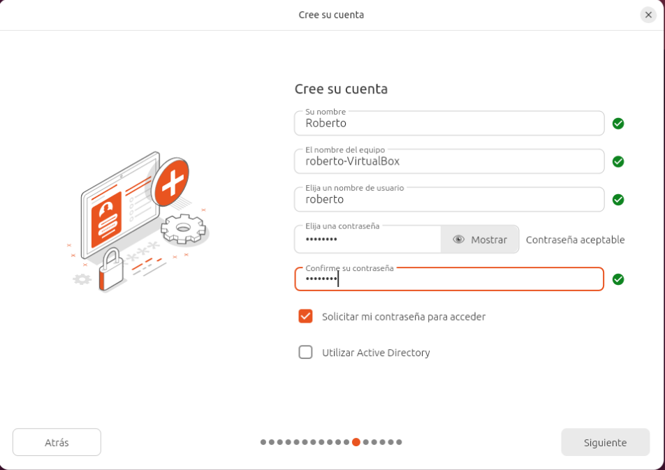
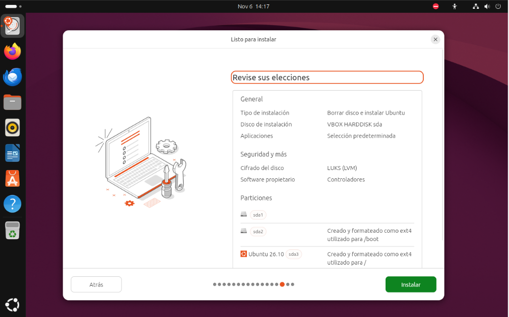
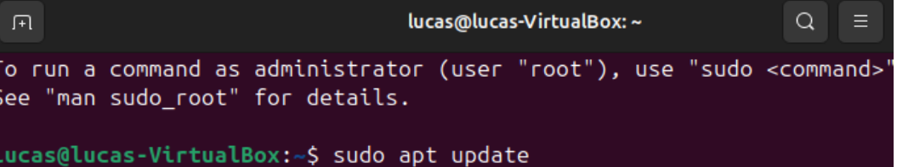
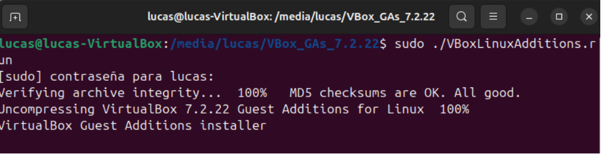

# Despliegue-SO

Instalación y configuración de Ubuntu en VirtualBox.

Realizado por Francisco, Roberto y Lucas.

## 1. Creación de la máquina virtual

Creamos la máquina y le asignamos la ISO de Ubuntu.


Asignamos la RAM, la CPU y el disco.


## 2. Arranque

Ponemos la unidad óptica primero en el orden de arranque.


Comprobamos que la ISO y el disco están conectados.



## 3. Instalación de Ubuntu

Elegimos el idioma.


Elegimos borrar el disco e instalar Ubuntu.


Creamos el usuario con una contraseña segura.



Revisamos el resumen e instalamos.



## 4. Guest Additions

Insertamos el CD de las Guest Additions.


Actualizamos la lista de paquetes.

```bash
sudo apt update
```



Instalamos las herramientas necesarias.

```bash
sudo apt install build-essential dkms linux-headers-$(uname -r)
```


Ejecutamos el instalador y reiniciamos.

```bash
sudo ./VBoxLinuxAdditions.run
```



Activamos el portapapeles bidireccional.


Activamos la pantalla dinámica.


## 5. Carpeta compartida

Añadimos la carpeta compartida en VirtualBox.


Añadimos el usuario al grupo `vboxsf`.

```bash
sudo usermod -aG vboxsf $USER
```


Comprobamos que funciona.


## 6. Segundo disco

Creamos un disco VDI de 15 GB.


Identificamos el disco.

```bash
lsblk
```


Creamos las particiones con `parted`.


Mostramos el disco sobre el que trabajamos.


Formateamos en FAT32.

```bash
sudo mkfs.vfat -F 32 /dev/sdb
```


Mostramos el disco con su formato.

```bash
lsblk -f /dev/sdb
```


## 7. Actualización del sistema

Actualizamos la lista de paquetes.

```bash
sudo apt update
```


Vemos los paquetes con una versión más nueva.

```bash
apt list --upgradable
```


Instalamos las actualizaciones.

```bash
sudo apt upgrade
```


