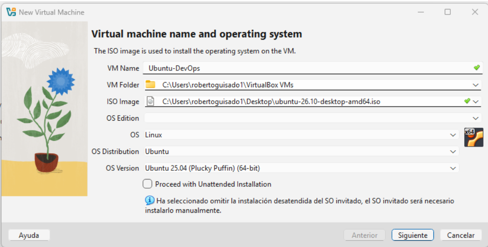
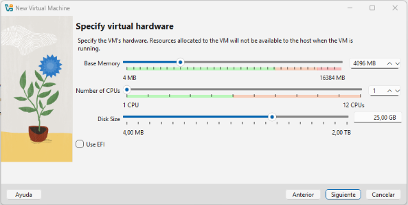
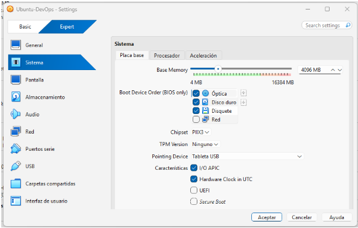
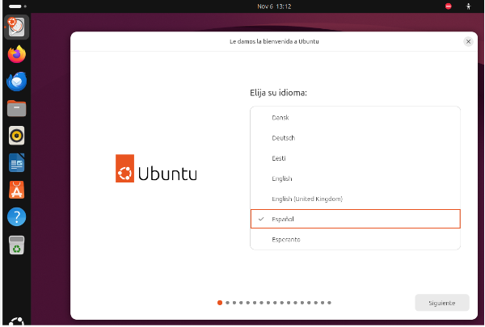
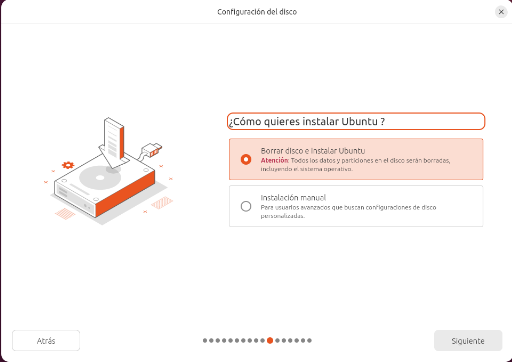
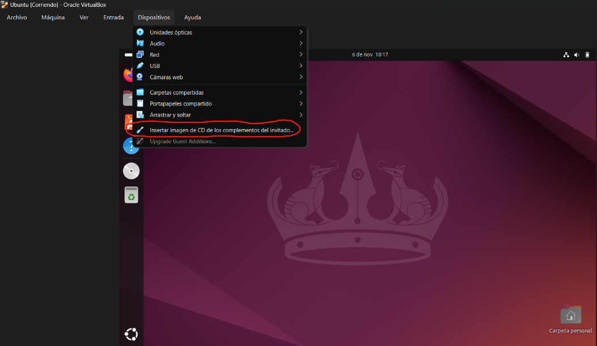
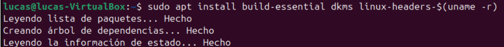

<div align="center">

# 🐧 Despliegue-SO

### Despliegue, configuración y documentación de Ubuntu en VirtualBox


**Trabajo de despliegue de Sistemas Operativos**
Realizado por **Francisco**, **Roberto** y **Lucas**

</div>

---

## 📋 Índice

- [Objetivo del trabajo](#-objetivo-del-trabajo)
- [Resumen de la máquina virtual](#-resumen-de-la-máquina-virtual)
- [Planificación y asignación de recursos](#1-planificación-y-asignación-de-recursos)
- [Secuencia de arranque](#2-secuencia-de-arranque)
- [Instalación limpia](#3-instalación-limpia)
- [Optimización e integración (Guest Additions)](#4-optimización-e-integración-guest-additions)
- [Carpeta compartida](#5-carpeta-compartida)
- [Creación de un segundo disco VDI](#6-creación-de-un-segundo-disco-vdi)
- [Actualización del sistema](#7-actualización-del-sistema)
- [Comandos utilizados](#-comandos-utilizados)
- [Conclusiones](#-conclusiones)

---

## 🎯 Objetivo del trabajo

El objetivo de esta práctica es **desplegar un sistema operativo Ubuntu Desktop dentro de una máquina virtual** con Oracle VirtualBox, documentando cada fase del proceso:

- Planificar y asignar los recursos de hardware virtual (RAM, CPU, disco).
- Configurar el orden de arranque para iniciar desde la imagen ISO.
- Realizar una instalación limpia del sistema con un usuario y contraseña segura.
- Optimizar la VM instalando las **Guest Additions** (portapapeles compartido, pantalla dinámica…).
- Configurar una **carpeta compartida** entre el equipo real (host) y la VM (invitado).
- Añadir y particionar un **segundo disco duro virtual**.
- Actualizar el sistema operativo y revisar los paquetes disponibles.

---

## 💻 Resumen de la máquina virtual

| Parámetro | Valor |
|---|---|
| **Nombre de la VM** | `Ubuntu-DevOps` |
| **Sistema operativo** | Ubuntu Desktop 26.10 (64-bit) |
| **Imagen ISO** | `ubuntu-26.10-desktop-amd64.iso` |
| **Memoria RAM** | 4096 MB (4 GB) |
| **Procesadores** | 1 CPU |
| **Disco principal** | 25 GB (VDI, controlador SATA) |
| **Disco secundario** | 15 GB (VDI dinámico) |
| **Firmware** | BIOS (EFI desactivado) |
| **Hipervisor** | Oracle VirtualBox 7.2.22 |
| **Equipo anfitrión** | Windows 11 |

---

## 1. Planificación y asignación de recursos

### Creación de la máquina virtual y asignación de la ISO

Creamos una nueva máquina virtual llamada **`Ubuntu-DevOps`** y le asignamos la imagen ISO de **Ubuntu 26.10 Desktop**. Seleccionamos como tipo *Linux → Ubuntu (64-bit)* y **desmarcamos la instalación desatendida**, para poder realizar la instalación manualmente y controlar cada paso.

<p align="center">
  
</p>

### Asignación de hardware

Asignamos los recursos de hardware teniendo en cuenta que lo que se reserva para la VM deja de estar disponible para el equipo real mientras está encendida:

- **RAM:** 4096 MB → suficiente para que el escritorio de Ubuntu funcione con fluidez.
- **CPU:** 1 núcleo.
- **Disco:** 25 GB, espacio de sobra para el sistema y las aplicaciones.

<p align="center">
  
</p>

---

## 2. Secuencia de arranque

### Orden de arranque

En **Configuración → Sistema → Placa base** establecemos el orden de arranque (BIOS) para que la VM arranque primero desde la unidad **Óptica** (donde está la ISO) y después desde el **Disco duro**. La opción de arranque por **Red** queda desactivada.

| Prioridad | Dispositivo | Estado |
|:---:|---|:---:|
| 1 | Óptica | ✅ |
| 2 | Disco duro | ✅ |
| 3 | Disquete | ✅ |
| 4 | Red | ❌ |

<p align="center">
  
</p>

### Comprobación del almacenamiento

En **Configuración → Almacenamiento** comprobamos que todo está bien conectado:

- **Controlador IDE:** imagen ISO `ubuntu-26.10-desktop-amd64.iso` (6,16 GB).
- **Controlador SATA:** disco virtual `Ubuntu-DevOps.vdi`.

<p align="center">
  
</p>

---

## 3. Instalación limpia

### Selección de idioma

Al arrancar desde la ISO aparece el asistente de instalación de Ubuntu. Seleccionamos **Español** como idioma del sistema.

<p align="center">
  
</p>

### Configuración del disco

Elegimos **«Borrar disco e instalar Ubuntu»**. Como se trata de un disco virtual nuevo y vacío, no se pierde ningún dato.

<p align="center">
  
</p>

### Creación de usuario y contraseña segura

Creamos la cuenta de usuario indicando el nombre, el nombre del equipo y el nombre de usuario. Establecemos una **contraseña segura** (el instalador la marca como *aceptable*) y dejamos activada la opción **«Solicitar mi contraseña para acceder»**.

<p align="center">
  
</p>

### Resumen e instalación

Antes de instalar revisamos el resumen de la configuración elegida:

- **Tipo de instalación:** Borrar disco e instalar Ubuntu
- **Disco de instalación:** VBOX HARDDISK `sda`
- **Cifrado del disco:** LUKS (LVM)
- **Particiones:** `sda2` → ext4 para `/boot` · `sda3` → ext4 para `/`

<p align="center">
  
</p>

---

## 4. Optimización e integración (Guest Additions)

Las **VirtualBox Guest Additions** son un conjunto de controladores que mejoran la integración entre el equipo real y la VM: permiten el portapapeles compartido, el ajuste automático de la resolución, las carpetas compartidas y un mejor rendimiento gráfico.

### Insertar el CD de las Guest Additions

Desde el menú de VirtualBox: **Dispositivos → Insertar imagen de CD de los complementos del invitado…**

<p align="center">
  
</p>

### Paso 1 — Actualizar la lista de paquetes

Actualizamos la lista de paquetes disponibles en los repositorios:

```bash
sudo apt update
```

<p align="center">
  
</p>

### Paso 2 — Instalar las herramientas de compilación

Las Guest Additions necesitan compilar módulos para el kernel, así que instalamos las herramientas necesarias:

```bash
sudo apt install build-essential dkms linux-headers-$(uname -r)
```

| Paquete | Para qué sirve |
|---|---|
| `build-essential` | Compiladores (gcc, make…) necesarios para compilar código |
| `dkms` | Recompila automáticamente los módulos cuando se actualiza el kernel |
| `linux-headers-$(uname -r)` | Cabeceras del kernel que está en uso ahora mismo |

<p align="center">
  
</p>

### Paso 3 — Ejecutar el instalador de las Guest Additions

Entramos en el CD montado y ejecutamos el instalador:

```bash
cd /media/$USER/VBox_GAs_7.2.22
sudo ./VBoxLinuxAdditions.run
```

> 💡 Después de la instalación hay que **reiniciar la máquina virtual** para que se carguen los nuevos módulos.

<p align="center">
  
</p>

### Portapapeles bidireccional

En **Dispositivos → Portapapeles compartido → Bidireccional** activamos el portapapeles compartido, para poder copiar y pegar texto en ambas direcciones (host ⇄ VM).

<p align="center">
  
</p>

### Pantalla dinámica

En **Ver → Ajuste automático del tamaño de pantalla invitada** activamos la pantalla dinámica y comprobamos que la resolución de Ubuntu se adapta sola al cambiar el tamaño de la ventana.

<p align="center">
  
</p>

---

## 5. Carpeta compartida

### Creación de la carpeta compartida

Creamos en el equipo real una carpeta llamada **`CompartidaPC`** y la añadimos en **Configuración → Carpetas compartidas** con las opciones:

- ✅ **Automontar** → se monta sola al arrancar la VM.
- ✅ **Hacer permanente** → la configuración se mantiene entre reinicios.

<p align="center">
  
</p>

### Añadir el usuario al grupo `vboxsf`

Por defecto, solo los miembros del grupo `vboxsf` pueden acceder a las carpetas compartidas, así que añadimos nuestro usuario a ese grupo:

```bash
sudo usermod -aG vboxsf $USER
```

> 💡 Para que el cambio de grupo tenga efecto hay que **cerrar sesión o reiniciar**.

<p align="center">
  
</p>

### Verificación

Para comprobar que funciona, creamos un archivo `.txt` y verificamos que aparece **tanto en la carpeta del equipo real como en la VM** (montada en `/media/sf_CompartidaPC`).

<p align="center">
  
</p>

---

## 6. Creación de un segundo disco VDI

### Crear el disco virtual

Desde el **selector de discos duros** de VirtualBox creamos un nuevo disco duro virtual:

- **Formato:** VDI (VirtualBox Disk Image)
- **Tamaño:** 15 GB
- **Tipo:** reservado dinámicamente (ocupa espacio en el equipo real solo a medida que se va llenando)

<p align="center">
  
</p>

### Identificar el disco

Arrancamos la VM y usamos `lsblk` para listar los dispositivos de bloque e identificar el disco sobre el que vamos a trabajar:

```bash
lsblk
```

<p align="center">
  
</p>

### Particionar el disco

Con `parted` creamos una tabla de particiones **GPT** y dos particiones de aproximadamente la mitad del disco cada una:

| Nº | Nombre | Tamaño | Sistema de archivos | Uso |
|:---:|---|---|---|---|
| 1 | `datos` | ~5,4 GB | ext4 | Datos de Linux |
| 2 | `compartido` | ~5,4 GB | FAT32 | Compatible con Windows y Linux |

Los pasos dentro de `parted` son, de forma resumida:

```bash
sudo parted /dev/<disco>
(parted) mklabel gpt
(parted) mkpart datos ext4 1MiB 50%
(parted) mkpart compartido fat32 50% 100%
(parted) print
```

<p align="center">
  
</p>

### Formateo y comprobación del segundo disco

Una vez creada la partición útil para compartir datos, la formateamos en FAT32 y comprobamos el resultado con `lsblk -f`:

```bash
sudo mkfs.vfat -F 32 /dev/sdb
lsblk -f /dev/sdb
```

<p align="center">
  
</p>

<p align="center">
  
</p>

---

## 7. Actualización del sistema

Actualizamos la lista de paquetes.

```bash
sudo apt update
```

<p align="center">
  
</p>

Vemos los paquetes con una versión más nueva.

```bash
apt list --upgradable
```

<p align="center">
  
</p>

Instalamos las actualizaciones.

```bash
sudo apt upgrade
```

<p align="center">
  
</p>

---

## 🧾 Comandos utilizados

| Comando | Descripción |
|---|---|
| `sudo apt update` | Actualiza la lista de paquetes disponibles |
| `sudo apt install build-essential dkms linux-headers-$(uname -r)` | Instala las herramientas para compilar los módulos del kernel |
| `sudo ./VBoxLinuxAdditions.run` | Instala las Guest Additions |
| `sudo usermod -aG vboxsf $USER` | Añade el usuario al grupo de carpetas compartidas |
| `lsblk` | Lista los discos y particiones del sistema |
| `sudo parted /dev/<disco>` | Abre la herramienta de particionado sobre un disco |
| `sudo mkfs.vfat -F 32 /dev/sdb` | Formatea la partición en FAT32 |
| `apt list --upgradable` | Muestra paquetes con versiones disponibles más nuevas |
| `sudo apt upgrade` | Instala las actualizaciones del sistema |

---

## ✅ Conclusiones

Con esta práctica hemos aprendido a:

- 🧩 **Planificar recursos** de una máquina virtual equilibrando lo que necesita la VM y lo que necesita el equipo real.
- 🔁 **Controlar la secuencia de arranque** para instalar un sistema desde una imagen ISO.
- 💿 **Instalar Ubuntu desde cero**, con usuario, contraseña segura y disco cifrado.
- ⚙️ **Integrar la VM con el host** gracias a las Guest Additions (portapapeles, pantalla dinámica, carpetas compartidas).
- 🗂️ **Añadir y particionar discos** desde la terminal con `lsblk` y `parted`.
- 🔄 **Mantener el sistema actualizado** revisando y aplicando paquetes nuevos de forma segura.

---

<div align="center">

**Francisco · Roberto · Lucas**

*Trabajo de Despliegue de Sistemas Operativos*

</div>
