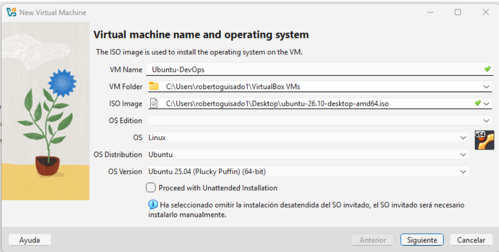
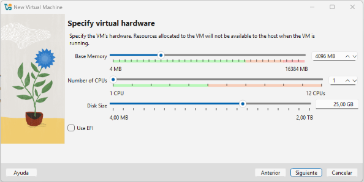
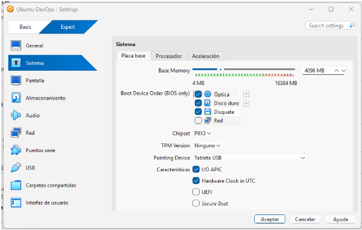
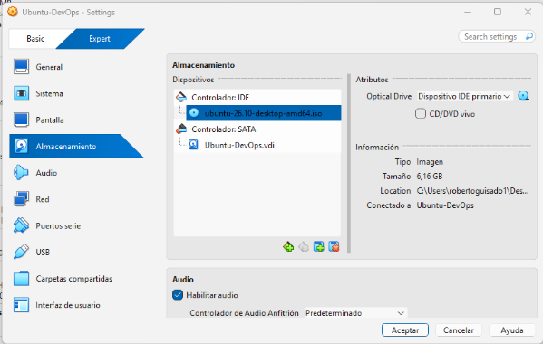
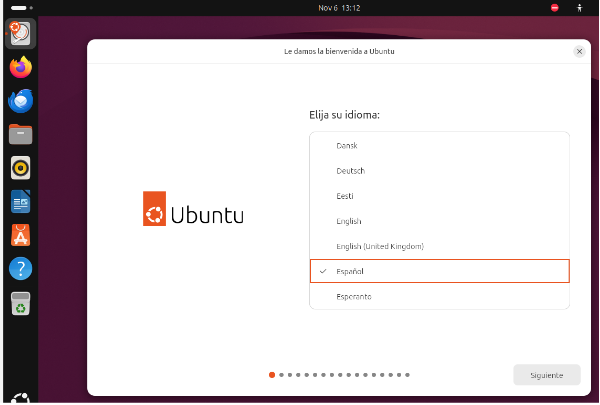
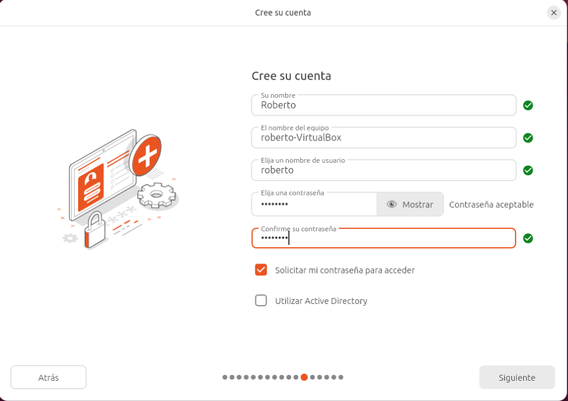

# Despliegue-SO
Despliegue, configuración y documentación de ubuntu en Virtual Box
## Trabajo de despliegue de SO
Hecho por Francisco, Roberto y Lucas

##PLANIFICACIÓN Y ASIGNACIÓN DE RECURSOS

##SECUENCIA DE ARRANQUE

##INSTALACIÓN LIMPIA

